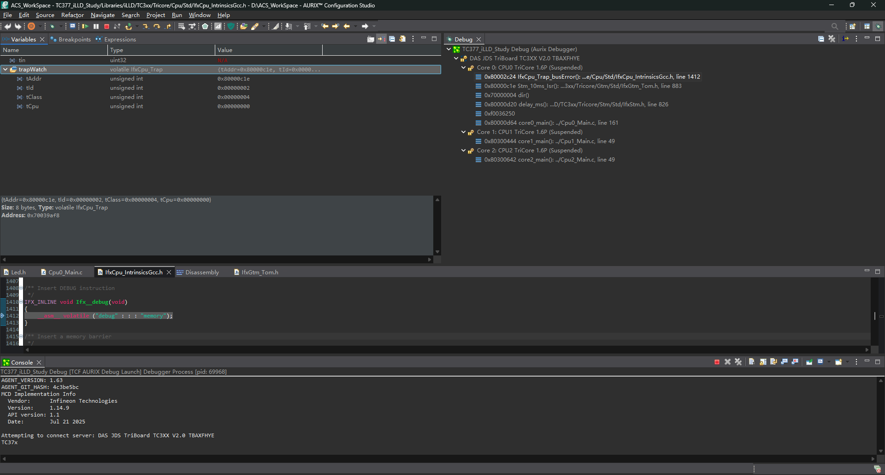

# STM 初始化顺序与 Trap 排查

## 本次问题



```c
Stm_Timer_Init();
delay_ms(20);
Gtm_Pwm_Init();
```

CPU0 已允许中断。STM 约 10 ms 后触发中断，忙等延时不会屏蔽中断。
ISR 调用 `IfxGtm_Tom_Pwm_setDuty()` 时，PWM 驱动尚未初始化。
全局驱动对象启动时为零，因此 `g_tomPwmDriver.tom` 是空指针。
驱动按这个指针计算 TOM 通道寄存器地址并读取，触发数据访问同步错误。

截图确认的信息（这些是 `trapWatch` 结构体字段，不是硬件寄存器本身）：

| 字段 | 值 | 含义 |
|---|---|---|
| tClass | 4 | 系统总线与外设错误类 |
| tId | 2 | 数据访问同步错误 DSE |
| tCpu | 0 | CPU0 触发 |
| tAddr | 0x80000c1e | 本次同步异常的故障指令地址，不是被访问的数据地址 |

调用栈显示 `IfxCpu_Trap_busError` 和 `Stm_10ms_Isr`，与上述路径一致。
内联函数会显示在 ISR 对应的源码位置；优化后的栈帧也可能出现不可靠的名字。

## 为什么会停在 debug 指令

CPU 并不是直接从错误访问跳到 `Ifx__debug()`，而是经过两层处理：

```text
ISR 执行无效地址读取
→ 硬件检测到数据访问错误，产生 Class 4 / TIN 2 Trap
→ CPU 保存执行上下文，记录异常返回地址，将 TIN 放入 D15
→ CPU 根据 BTV 寄存器找到 Class 4 的 Trap 向量入口
→ 向量入口代码跳转到 IfxCpu_Trap_busError(tin)
→ 软件填写 trapWatch，并执行默认宏 __debug()
→ 编译生成的 debug 指令让已连接的调试器暂停
```

BTV 是 Trap 向量表基地址，启动代码已配置。每类入口占 32 字节。
入口地址为 `BTV | (tClass << 5)`；基地址按 256 字节对齐时，Class 4 入口就是 `BTV + 0x80`。
这是 CPU 硬件的异常跳转规则；向量表与处理函数则是工程提供的软件。
Trap 不需要普通中断使能才能响应，ISR 内也能触发 Trap。

本地 `IfxCpu_Trap.c` 的向量表将总线错误映射到 `IfxCpu_Trap_busError`。
该处理函数的 `IFX_CFG_CPU_TRAP_DEBUG` 默认展开为 `__debug()`。
`Ifx__debug()` 中的 `__asm__ volatile ("debug" : : : "memory")` 插入一条 debug 指令；
`volatile` 防止编译器将它随意删除，`memory` 告诉编译器该汇编可能影响内存。
它是异常后的调试暂停点，不是最初的故障指令，也不会修复错误。

## 排查步骤

1. 停在 debug 时，在 ACS 的 Debug 调用栈选中 `IfxCpu_Trap_busError`，展开 Variables 中的 `trapWatch`。
2. 用 `tClass` 和 `tId` 确定异常类别。不要仅凭停在 debug 就断定是空指针。
3. 在 Disassembly 中查看 `tAddr` 对应指令，确认它读取或写入了什么地址。
4. 查看调用栈中的 ISR；本例在 `setDuty()` 前观察 `g_tomPwmDriver.tom`，确认是否为零。
5. 对数据访问错误，可结合 CPU0 的 DSTR、DEADD 查看错误状态和数据地址；只有相应状态有效时才解释 DEADD。
6. 修复原因后重新编译、烧录并复现验证。直接 Resume 可能再次执行故障指令并再次 Trap。

若在 Trap 向量入口打断点，可看 D15 中的 TIN、A11 中的同步异常地址；
到了 C 处理函数后寄存器可能已经被使用，优先看保存的 `trapWatch`。
截图中 `tin` 显示 N/A 不代表没有异常编号，`trapWatch.tId` 已保存为 2。

## 修复

```c
Gtm_Pwm_Init();   // 先初始化 ISR 要使用的 PWM 驱动
Stm_Timer_Init(); // 再启动中断来源
```

未初始化指针、数组越界产生的无效地址、错误的外设基地址，都可能造成数据访问异常；
具体原因必须结合故障指令和地址确认。本例与 ENDINIT 解锁无关。

## 参考

- [英飞凌 Trap 调试步骤](https://community.infineon.com/t5/Knowledge-Base-Articles/Debug-Code-When-a-Trap-is-Asserted-AURIX-MCU/ta-p/339808)
- [英飞凌 Trap 向量表映射](https://community.infineon.com/t5/Knowledge-Base-Articles/AURIX-MCU-Map-a-trap-vector-table-by-a-TriCore-MCU-KBA234661/ta-p/337932)
- 本地源码：`Libraries/iLLD/TC3xx/Tricore/Cpu/Trap/IfxCpu_Trap.c`、`IfxCpu_Trap.h`。
